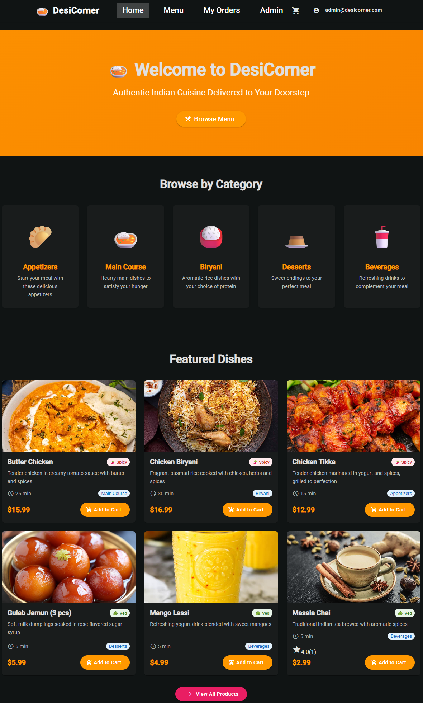
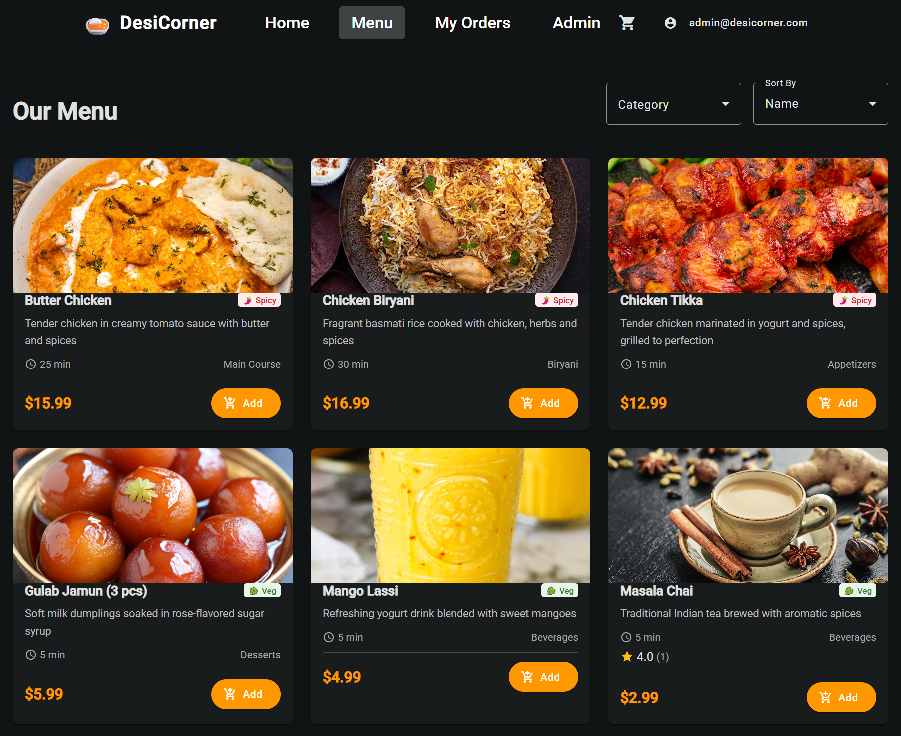
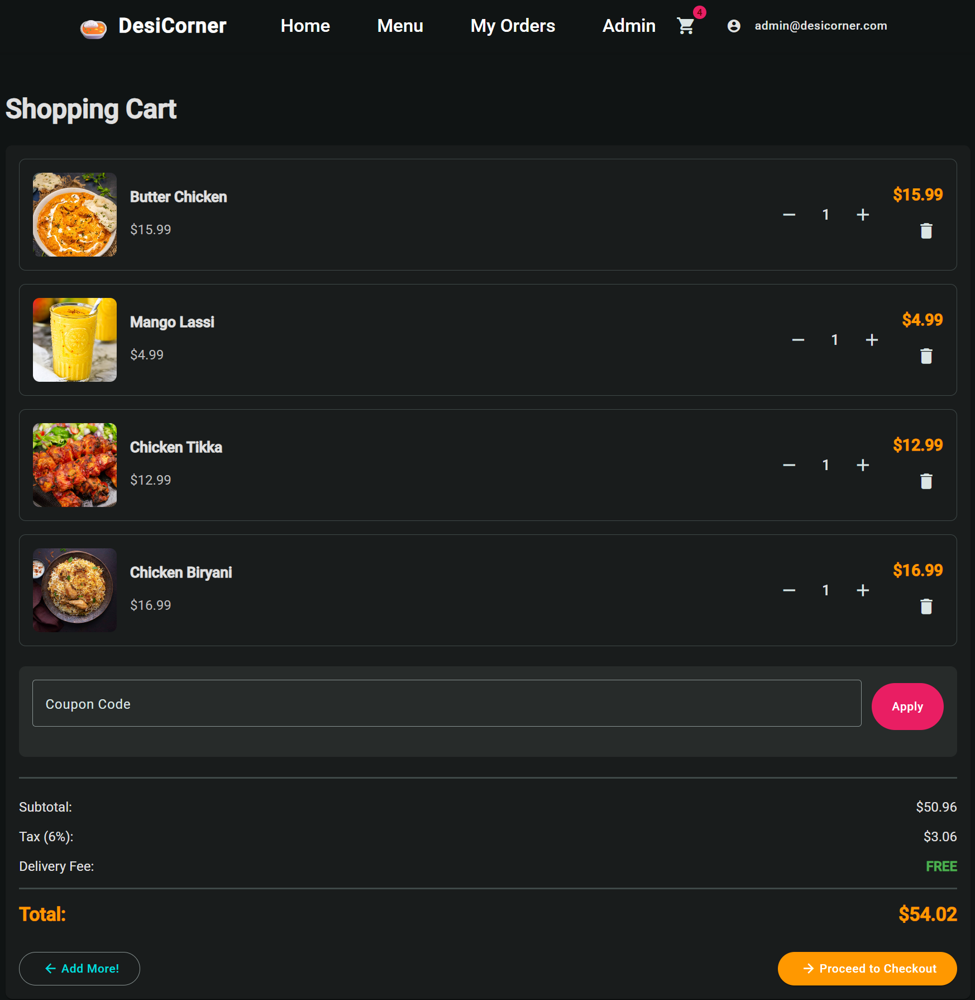
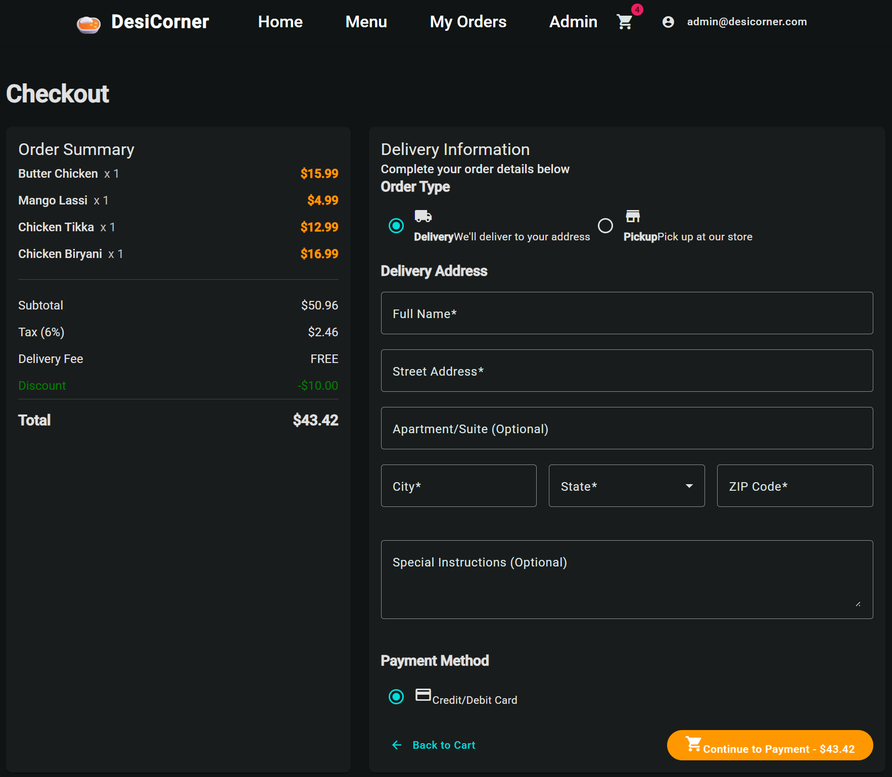
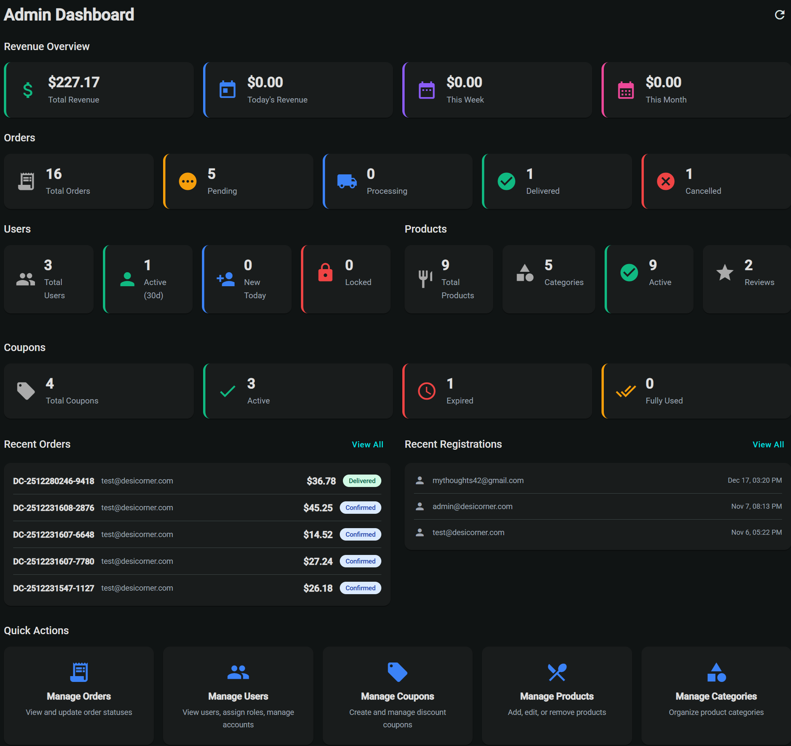
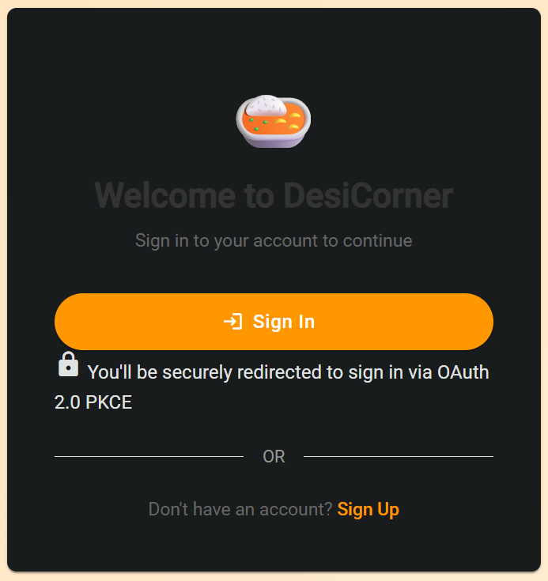
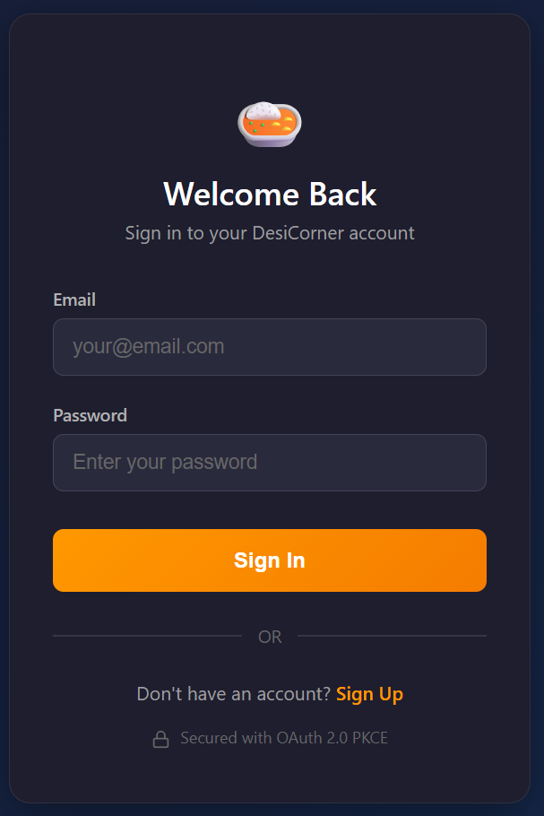
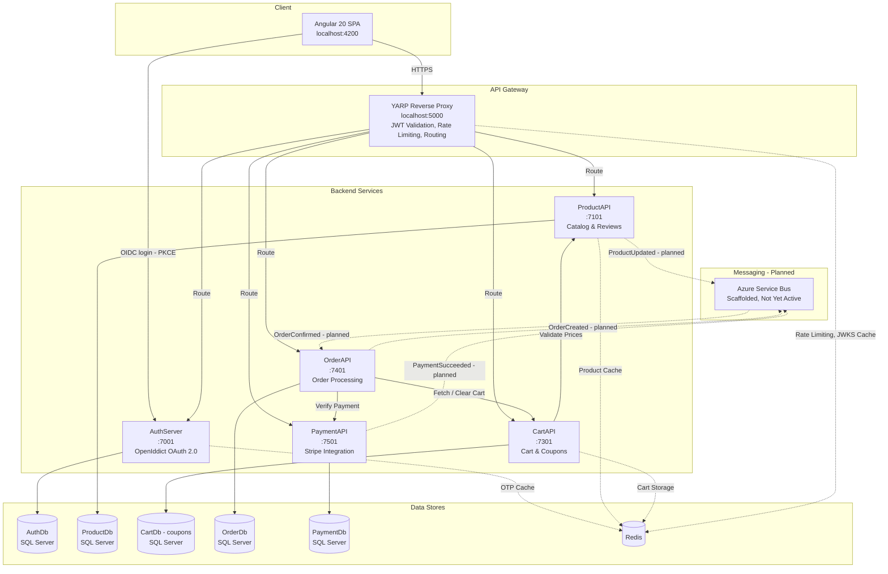
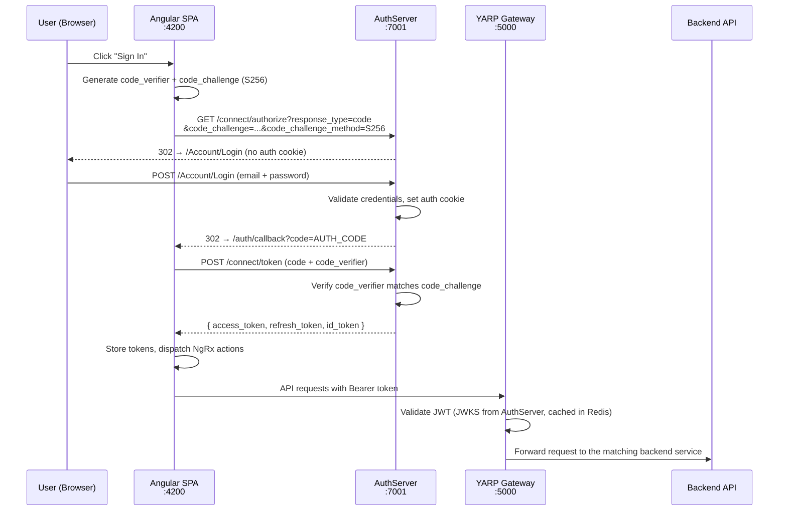

<div align="center">

# DesiCorner

**Microservices E-Commerce Platform for Indian Cuisine**

[](https://dotnet.microsoft.com/download/dotnet/8.0)
[](https://angular.dev)
[](LICENSE.txt)

*A portfolio project: 7 runnable services (an OpenIddict auth server, a YARP gateway, four ASP.NET Core APIs and an Angular SPA) plus 2 shared class libraries. It demonstrates OAuth 2.0 Authorization Code + PKCE, API-gateway routing, Redis caching and rate limiting, and Stripe payments.*

> **Status:** a learning and portfolio build, not a production deployment. It has no automated tests, no CI and no containers yet, and it has open security items. See [Known limitations and roadmap](#known-limitations-and-roadmap).

</div>

---

<div align="center">

| Homepage | Menu | Cart |
|----------|------|------|
|  |  |  |

| Checkout | Admin Dashboard |
|----------|-----------------|
|  |  |

| Login (Angular -- PKCE Redirect) | Login (AuthServer -- Razor Page) |
|---------------------------------|---------------------------------|
|  |  |

</div>

---

<p align="center">
  <a href="#architecture-overview">Architecture</a> &bull;
  <a href="#tech-stack">Tech Stack</a> &bull;
  <a href="#getting-started">Getting Started</a> &bull;
  <a href="#api-documentation">API Docs</a> &bull;
  <a href="#project-structure">Project Structure</a> &bull;
  <a href="#known-limitations-and-roadmap">Limitations</a> &bull;
  <a href="docs/Development_Report.md">Development Report</a>
</p>

<details>
<summary>Table of Contents</summary>

- [Architecture Overview](#architecture-overview)
- [Service Inventory](#service-inventory)
- [Tech Stack](#tech-stack)
- [Key Features](#key-features)
- [Getting Started](#getting-started)
  - [Prerequisites](#prerequisites)
  - [1. Clone and trust the HTTPS dev certificate](#1-clone-and-trust-the-https-dev-certificate)
  - [2. Start SQL Server and Redis](#2-start-sql-server-and-redis)
  - [3. Configure secrets](#3-configure-secrets)
  - [4. Create the databases](#4-create-the-databases)
  - [5. Start the backend services](#5-start-the-backend-services)
  - [6. Start the Angular frontend](#6-start-the-angular-frontend)
  - [7. Verify](#7-verify)
- [Project Structure](#project-structure)
- [API Documentation](#api-documentation)
- [Architectural Decisions](#architectural-decisions)
- [Evaluated and Chose Not to Use](#evaluated-and-chose-not-to-use)
- [Development Process](#development-process)
- [Development Report](docs/Development_Report.md)
- [Known Limitations and Roadmap](#known-limitations-and-roadmap)
- [License](#license)

</details>

---

## Architecture Overview

Ports below are the `https` launch profiles in each project's `Properties/launchSettings.json`.



### OAuth 2.0 Authorization Code + PKCE Flow



### Service Inventory

**Runnable services (7)**

| Service | Port (https profile) | Technology | Data store | Description |
|---------|------|-----------|----------|-------------|
| **[AuthServer](./DesiCorner.AuthServer/)** | 7001 | .NET 8, OpenIddict 7.1, ASP.NET Core Identity, MailKit | SQL Server (AuthDb + DataProtection DB), Redis | OAuth 2.0 / OpenID Connect server, login UI (Razor Pages), email OTP, role management |
| **[Gateway](./DesiCorner.Gateway/)** | 5000 | YARP 2.3, OpenTelemetry instrumentation | Redis | Reverse proxy with JWT validation (JWKS, introspection fallback), scope policies, Redis rate limiting |
| **[ProductAPI](./DesiCorner.Services.ProductAPI/)** | 7101 | .NET 8, EF Core | SQL Server (ProductDb), Redis | Product catalog, categories, image upload, reviews, ratings and review votes |
| **[CartAPI](./DesiCorner.Services.CartAPI/)** | 7301 | .NET 8, EF Core, StackExchange.Redis | Redis (carts), SQL Server (CartDb: coupons) | Shopping cart stored in Redis with a 30-day expiry; coupon management in SQL Server |
| **[OrderAPI](./DesiCorner.Services.OrderAPI/)** | 7401 | .NET 8, EF Core | SQL Server (OrderDb) | Order creation, guest checkout, delivery/pickup options, admin order views |
| **[PaymentAPI](./DesiCorner.Services.PaymentAPI/)** | 7501 | .NET 8, Stripe.net 50.0, Serilog | SQL Server (PaymentDb) | Stripe PaymentIntents, payment verification, webhook endpoint |
| **[Frontend](./desicorner-angular/)** | 4200 | Angular 20, NgRx, Angular Material | -- | SPA with OAuth 2.0 PKCE login, Stripe Elements checkout, admin dashboard |

**Shared libraries (2)**

| Library | Technology | Description |
|---------|-----------|-------------|
| **[MessageBus](./DesiCorner.MessageBus/)** | StackExchange.Redis, Azure.Messaging.ServiceBus | Redis cache abstraction (used by ProductAPI). Service Bus publisher/consumer classes are written and registered in ProductAPI's DI container, but no code publishes or consumes messages yet |
| **[Contracts](./DesCorner.Contracts/)** | .NET 8 class library | Shared DTOs (41 files in 9 folders) and the `ResponseDto` envelope |

---

## Tech Stack

### Backend

| Technology | Version | Purpose |
|-----------|---------|---------|
| .NET | 8.0 LTS | Service framework |
| Entity Framework Core | 8.0.21 | ORM with code-first migrations |
| OpenIddict | 7.1.0 | OAuth 2.0 / OpenID Connect server |
| YARP | 2.3.0 | Reverse proxy API gateway |
| Stripe.net | 50.0.0 | Payment processing |
| Azure Service Bus | 7.20.1 | Async messaging (scaffolded, not yet active) |
| StackExchange.Redis | 2.9–2.10 | Caching, cart storage, rate limiting, OTP storage |
| OpenTelemetry | 1.13.x | Tracing and metrics instrumentation (Gateway only; no exporter configured yet) |
| Serilog | 8.0.3 | Structured logging (PaymentAPI) |
| Swashbuckle | 6.6–9.0 | Swagger/OpenAPI docs |
| MailKit | 4.14.1 | SMTP email (OTP delivery) |
| Twilio | 7.13.5 | Package referenced; SMS OTP delivery is not implemented yet |

### Frontend

| Technology | Version | Purpose |
|-----------|---------|---------|
| Angular | 20.3 | SPA framework |
| TypeScript | 5.9.2 | Type-safe development |
| NgRx | 20.1.0 | Redux-style state management |
| Angular Material | 20.2.11 | Material Design UI components |
| angular-oauth2-oidc | 20.0.2 | OAuth 2.0 / PKCE client |
| ngx-stripe / @stripe/stripe-js | 21.8.0 / 8.5.3 | Stripe Elements integration |
| RxJS | 7.8.0 | Reactive programming |

### Infrastructure

| Technology | Purpose |
|-----------|---------|
| SQL Server | Relational databases (5 service databases plus a Data Protection key database for AuthServer) |
| Redis | Caching, cart storage, rate limiting, OTP storage, JWKS cache |
| Git + GitHub | Branch-per-feature workflow with 21 merged pull requests |

---

## Key Features

### Architecture & Infrastructure
- **Service decomposition** -- 7 runnable services with a database-per-service pattern, plus 2 shared libraries
- **API Gateway** -- YARP reverse proxy with config-driven routes, a custom token authenticator (JWT-first with JWKS cached in Redis, introspection fallback), scope-based policies and Redis-based rate limiting
- **Event-Driven Messaging (Scaffolded)** -- Azure Service Bus publisher, consumer and message types exist but are not used at runtime. Inter-service communication is synchronous HTTP today
- **Redis** -- product caching, cart storage, rate limiting, OTP storage
- **Observability** -- OpenTelemetry tracing and metrics instrumentation in the Gateway; Serilog structured logging in PaymentAPI; `ILogger` message templates elsewhere
- **Shared Contracts** -- one DTO library used by all services

### Authentication & Security
- **OAuth 2.0 / OpenID Connect** -- OpenIddict authorization server; the SPA uses Authorization Code + PKCE (S256 required for the public client)
- **JWT Authentication** -- access tokens validated at the gateway and in each API; AuthServer supports cookie and JWT schemes
- **Role-Based Access Control** -- Admin and Customer roles with per-endpoint authorization
- **OTP Verification** -- Redis-backed OTP for registration and guest checkout, delivered by email (MailKit). SMS delivery is not implemented yet
- **Rate limiting** -- Redis fixed-window limits on login/register and at the gateway

### Business Features
- **Product Catalog** -- categories, category filtering and sorting, image upload to local storage
- **Reviews & Ratings** -- star ratings, written reviews, helpful/not-helpful voting, verified-purchase flag
- **Shopping Cart** -- authenticated and guest carts stored in Redis
- **Coupon System** -- percentage and fixed-amount discounts with validation rules
- **Order Processing** -- delivery and pickup options, order history, admin status updates
- **Guest Checkout** -- checkout without registration using email OTP verification
- **Stripe Payments** -- PaymentIntents with Stripe Elements, so card data goes from the browser to Stripe and never reaches the backend
- **Admin Dashboard** -- analytics, product/category/coupon management, user/role management, order management

---

## Getting Started

> **Build verified on 2026-10-27** (Windows 11, .NET SDK 10.0.301 with the .NET 8 runtime, Node 24.18.0, npm 11.16.0): `dotnet build DesiCorner.sln` succeeded with 0 errors and 10 warnings. The Angular app installs only with `npm ci --legacy-peer-deps` (see the note in step 6; checked with `--ignore-scripts` added), then `npx ng build` succeeds with bundle-budget warnings. The services were not started end to end during that check, because they need SQL Server, Redis and Stripe keys.

### Prerequisites

| Tool | Version | Verify | Notes |
|------|---------|--------|-------|
| .NET SDK | 8.0 or later, with the .NET 8 / ASP.NET Core 8 runtime | `dotnet --list-sdks`, `dotnet --list-runtimes` | Projects target `net8.0`; there is no `global.json`, so a newer SDK also builds them |
| EF Core CLI | any recent `dotnet-ef` | `dotnet ef --version` | `dotnet tool install --global dotnet-ef` |
| Node.js | `^20.19.0`, `^22.12.0` or `>=24.0.0` | `node --version` | Required by Angular 20.3 (`@angular/core` engines field) |
| npm | bundled with Node | `npm --version` | |
| SQL Server | 2019+ (Developer or Express) | -- | Connection strings default to `localhost` |
| Redis | 7.x | `redis-cli ping` | Expected on `localhost:6379` |
| Stripe account | test mode | -- | Free test keys at [dashboard.stripe.com](https://dashboard.stripe.com/register) |

The Angular CLI does not need a global install; the commands below use `npx ng`.

### 1. Clone and trust the HTTPS dev certificate

```bash
git clone https://github.com/HariVenkataKrishnaKotha/DesiCorner.git
cd DesiCorner
dotnet dev-certs https --trust
```

All service-to-service URLs in `appsettings.json` use `https://localhost:<port>`, so the dev certificate is needed.

### 2. Start SQL Server and Redis

Run SQL Server and Redis locally (a native install, WSL or a container of your choice). Check Redis:

```bash
redis-cli ping
# Expected: PONG
```

### 3. Configure secrets

The checked-in `appsettings.json` files contain **development defaults only**: `sa` connection strings with a placeholder-style password, a development JWT secret, and empty or placeholder Stripe and SMTP values. Override them locally; do not commit real values.

None of the projects has a `UserSecretsId` yet, so run `dotnet user-secrets init` once per project before setting values. (`init` adds a `UserSecretsId` to the `.csproj`.) User secrets are loaded automatically when `ASPNETCORE_ENVIRONMENT=Development`, which the launch profiles set.

| Project | Keys to set | Notes |
|---------|------------|-------|
| `DesiCorner.AuthServer` | `ConnectionStrings:Default`, `ConnectionStrings:DataProtection`, `JwtSettings:Secret`, `Email:From`, `Email:SmtpServer`, `Email:SmtpPort`, `Email:Username`, `Email:Password`, `Redis:Configuration` | SMTP is needed for email OTP |
| `DesiCorner.Gateway` | `Redis:Configuration`, `Gateway:Introspection:ClientSecret` | The introspection secret must match the `desicorner-gateway` client secret seeded in `DesiCorner.AuthServer/Infrastructure/Seed.cs` |
| `DesiCorner.Services.ProductAPI` | `ConnectionStrings:Default`, `Redis:Configuration`, `JwtSettings:Secret` | ProductAPI refuses to start if `JwtSettings:Secret` is empty, although it validates tokens through the AuthServer's JWKS |
| `DesiCorner.Services.CartAPI` | `ConnectionStrings:CartDb`, `ConnectionStrings:Redis` | |
| `DesiCorner.Services.OrderAPI` | `ConnectionStrings:DefaultConnection` | |
| `DesiCorner.Services.PaymentAPI` | `ConnectionStrings:DefaultConnection`, `Stripe:SecretKey`, `Stripe:PublishableKey`, `Stripe:WebhookSecret` | The SPA fetches the publishable key from `GET /api/payment/config` |

Example (the same in PowerShell and bash):

```bash
dotnet user-secrets init --project DesiCorner.Services.PaymentAPI
dotnet user-secrets set "Stripe:SecretKey" "sk_test_<your-test-key>" --project DesiCorner.Services.PaymentAPI
dotnet user-secrets set "Stripe:PublishableKey" "pk_test_<your-test-key>" --project DesiCorner.Services.PaymentAPI
dotnet user-secrets set "Stripe:WebhookSecret" "whsec_<your-webhook-secret>" --project DesiCorner.Services.PaymentAPI
dotnet user-secrets set "ConnectionStrings:DefaultConnection" "Server=localhost;Database=DesiCornerPaymentsDb;Trusted_Connection=True;TrustServerCertificate=True;" --project DesiCorner.Services.PaymentAPI
```

Environment variables also work (use `__` for the `:` separator) and apply to every service started from that shell:

```powershell
# PowerShell
$env:Stripe__SecretKey = "sk_test_<your-test-key>"
```

```bash
# bash
export Stripe__SecretKey="sk_test_<your-test-key>"
```

> `.env.example` lists the values you will need, but no service reads a `.env` file or those variable names. Use user-secrets or `Section__Key` environment variables as shown above.

### 4. Create the databases

**AuthServer** and **OrderAPI** apply their EF Core migrations automatically at startup. AuthServer also seeds roles, the OpenIddict clients and two development accounts (see `DesiCorner.AuthServer/Data/DbInitializer.cs`).

Create the other three databases with the EF Core CLI:

```bash
dotnet ef database update --project DesiCorner.Services.ProductAPI
dotnet ef database update --project DesiCorner.Services.CartAPI
dotnet ef database update --project DesiCorner.Services.PaymentAPI
```

If you want to migrate AuthServer by hand, it has two DbContexts, so name each one:

```bash
dotnet ef database update --project DesiCorner.AuthServer --context ApplicationDbContext
dotnet ef database update --project DesiCorner.AuthServer --context DataProtectionKeyContext
```

### 5. Start the backend services

Start each service in its own terminal with the **`https` launch profile**. Without `--launch-profile https`, `dotnet run` uses the first profile (`http`), so the services listen on different ports (CartAPI 5227, OrderAPI 5158, PaymentAPI 5197) or on HTTP only, which do not match the gateway and service URLs in `appsettings.json`.

Start AuthServer first, because it runs migrations and seeds the OpenIddict clients:

```bash
dotnet run --project DesiCorner.AuthServer --launch-profile https              # https://localhost:7001
dotnet run --project DesiCorner.Services.ProductAPI --launch-profile https     # https://localhost:7101
dotnet run --project DesiCorner.Services.CartAPI --launch-profile https        # https://localhost:7301
dotnet run --project DesiCorner.Services.OrderAPI --launch-profile https       # https://localhost:7401
dotnet run --project DesiCorner.Services.PaymentAPI --launch-profile https     # https://localhost:7501
dotnet run --project DesiCorner.Gateway --launch-profile https                 # https://localhost:5000
```

### 6. Start the Angular frontend

```bash
cd desicorner-angular
npm ci --legacy-peer-deps
npx ng serve    # http://localhost:4200
```

> **Why `--legacy-peer-deps`:** `ngx-stripe@21.8.0` declares a peer dependency on Angular 21, while the app uses Angular 20.3, so a plain `npm ci` fails with `ERESOLVE`. With the flag, the install and the production build both succeed. Aligning the versions is on the roadmap.

The development environment (`src/environments/environment.ts`) points the SPA at the gateway (`https://localhost:5000`) and the AuthServer issuer (`https://localhost:7001/`) with client ID `desicorner-angular`. The AuthServer registers `http://localhost:4200/auth/callback` and `https://localhost:4200/auth/callback` as redirect URIs.

### 7. Verify

- Open http://localhost:4200. You should see the DesiCorner homepage.
- Check the gateway at https://localhost:5000/health/ready.
- Sign in with one of the seeded development accounts from `DbInitializer.cs` (change those passwords if you expose the app anywhere), browse products and add items to the cart.

**Service access points** (Swagger UI is enabled only in the `Development` environment):

| Service | URL |
|---------|-----|
| Frontend | http://localhost:4200 |
| API Gateway | https://localhost:5000 (`/health/live`, `/health/ready`) |
| AuthServer Swagger | https://localhost:7001/swagger |
| ProductAPI Swagger | https://localhost:7101/swagger |
| CartAPI Swagger | https://localhost:7301/swagger |
| OrderAPI Swagger | https://localhost:7401/swagger |
| PaymentAPI Swagger | https://localhost:7501/swagger |

---

## Project Structure

```
DesiCorner/
├── DesCorner.Contracts/            # Shared DTOs (class library)
│   ├── Admin/                      #   DashboardStatsDto
│   ├── Auth/                       #   Login, Register, User, OTP, Address, AdminUser DTOs
│   ├── Cart/                       #   Cart, AddToCart, UpdateCartItem, ApplyCoupon DTOs
│   ├── Common/                     #   ResponseDto, PaginatedResponse
│   ├── Coupons/                    #   Coupon, AdminCoupon, validation DTOs
│   ├── Orders/                     #   Order, OrderSummary, OrderType, UpdateOrderStatus, AdminOrder DTOs
│   ├── Payment/                    #   PaymentIntent, Webhook, VerifyPayment DTOs
│   ├── Products/                   #   Product, Category, ProductStats DTOs
│   └── Reviews/                    #   Review, ReviewSummary, ReviewVote DTOs
│
├── DesiCorner.AuthServer/          # OAuth 2.0 / OIDC server (Port 7001)
│   ├── Controllers/                #   AccountController, AuthorizationController, AdminController
│   ├── Data/                       #   ApplicationDbContext, DataProtectionKeyContext, DbInitializer
│   ├── Identity/                   #   ApplicationUser, ApplicationRole, DeliveryAddress
│   ├── Infrastructure/             #   OpenIddict client seeding (Seed.cs)
│   ├── Migrations/                 #   EF Core migrations (both contexts)
│   ├── Models/                     #   JwtSettings
│   ├── Pages/                      #   Razor Pages for the login/logout UI
│   └── Services/                   #   TokenService, EmailService, OtpService, RedisKeys
│
├── DesiCorner.Gateway/             # YARP API Gateway (Port 5000)
│   ├── Auth/                       #   TokenAuthenticator, JwksProvider, IntrospectionClient, RedisRateLimiter
│   ├── Infrastructure/             #   Problem-details helper
│   ├── Policies/                   #   ScopeAuthorizationHandler, ScopeRequirement
│   └── Transforms/                 #   ForwardingTransforms
│
├── DesiCorner.MessageBus/          # Shared messaging and caching library
│   ├── Extensions/                 #   Service collection extensions
│   ├── Messages/                   #   OrderCreated, OrderConfirmed, PaymentSucceeded, PaymentFailed
│   ├── Redis/                      #   CacheService abstraction
│   └── ServiceBus/                 #   Azure Service Bus publisher/consumer (not yet used)
│
├── DesiCorner.Services.ProductAPI/ # Product catalog service (Port 7101)
│   ├── Controllers/                #   ProductsController, CategoriesController, ReviewsController
│   ├── Data/                       #   ProductDbContext
│   ├── Models/                     #   Product, Category, Review, ReviewVote
│   └── Services/                   #   ProductService, CategoryService, ReviewService, LocalImageStorageService
│
├── DesiCorner.Services.CartAPI/    # Cart service (Port 7301)
│   ├── Controllers/                #   CartController, CouponsController
│   ├── Data/                       #   CartDbContext (coupons)
│   ├── Models/                     #   Cart, CartItem, Coupon
│   └── Services/                   #   CartService (Redis), CouponService, ProductService client
│
├── DesiCorner.Services.OrderAPI/   # Order service (Port 7401)
│   ├── Controllers/                #   OrdersController
│   ├── Data/                       #   OrderDbContext
│   ├── Models/                     #   Order, OrderItem
│   └── Services/                   #   OrderService, OtpService, UserService
│
├── DesiCorner.Services.PaymentAPI/ # Stripe payment service (Port 7501)
│   ├── Controllers/                #   PaymentController
│   ├── Data/                       #   PaymentDbContext
│   ├── Models/                     #   Payment
│   └── Services/                   #   PaymentService
│
├── desicorner-angular/             # Angular 20 SPA (Port 4200)
│   └── src/app/
│       ├── core/                   #   Guards, interceptors, models, services
│       ├── features/               #   Home, Auth, Admin, Cart, Checkout, Products, Profile, Orders
│       ├── store/                  #   NgRx store (auth, cart, product: actions, reducers, effects, selectors)
│       └── shared/                 #   Header, Footer, StarRating, review components
│
├── docs/
│   ├── Development_Report.md       # Phase-by-phase build log, bug list, attribution
│   └── images/                     # Screenshots
│
├── .env.example                    # Reference list of required values (not read by the code)
├── CONTRIBUTING.md
├── DesiCorner.sln                  # .NET solution file
├── LICENSE.txt
└── README.md                       # You are here
```

---

## API Documentation

Every backend API exposes **Swagger UI** in the `Development` environment:

| Service | Swagger URL | Key Endpoints |
|---------|------------|---------------|
| AuthServer | `https://localhost:7001/swagger` | `POST /api/account/login`, `POST /api/account/register`, `GET /api/account/profile` |
| ProductAPI | `https://localhost:7101/swagger` | `GET /api/products`, `GET /api/categories`, `POST /api/reviews` |
| CartAPI | `https://localhost:7301/swagger` | `GET /api/cart`, `POST /api/cart/add`, `POST /api/cart/apply-coupon` |
| OrderAPI | `https://localhost:7401/swagger` | `POST /api/orders`, `GET /api/orders/my-orders` |
| PaymentAPI | `https://localhost:7501/swagger` | `POST /api/payment/create-intent`, `POST /api/payment/verify` |

Most endpoints require a bearer token issued by the AuthServer; use the "Authorize" button in Swagger UI to set one. Some endpoints are anonymous on purpose (login, register, OTP, guest cart operations, payment-intent creation, and order/payment lookup by ID). Several of those are listed as open issues in [Known limitations](#known-limitations-and-roadmap).

To get a token for Swagger, sign in through the SPA and copy the access token from the browser's storage.

See each service's README for its full endpoint list.

---

## Architectural Decisions

| Decision | Choice | Why |
|----------|--------|-----|
| Auth framework | OpenIddict 7.1 | Open source (Apache 2.0), actively maintained, and integrates directly with ASP.NET Core Identity. See [Evaluated and chose not to use](#evaluated-and-chose-not-to-use). |
| API Gateway | YARP | Microsoft-maintained reverse proxy toolkit with config-driven routes and clusters. Because it is ordinary ASP.NET Core middleware, the custom token authenticator, scope policies and rate limiter sit in the same pipeline. |
| Database strategy | Database-per-service | Each service owns its data and migrations, so services can be changed and migrated independently. |
| Cart storage | Redis | Carts are stored as JSON in Redis with a 30-day expiry. `CartDb` (SQL Server) holds coupons only, so carts are not durable if Redis is flushed. |
| Messaging | Azure Service Bus (scaffolded) | Publisher/consumer code exists but is not used. All inter-service communication is synchronous HTTP today. |
| Frontend state | NgRx (Redux pattern) | Predictable state for cart, auth and catalog interactions; Redux DevTools support. |
| Auth flow | Authorization Code + PKCE with JWT access tokens | Stateless tokens work across services without shared session state. PKCE protects the authorization code for a public SPA client. |
| Payment processing | Stripe Elements (client-side) | Card details go from the browser to Stripe; the backend handles only PaymentIntent IDs and statuses. This keeps raw card data off the servers. |

---

## Evaluated and Chose Not to Use

Only alternatives recorded in this repository's own docs are listed here.

| Alternative | Chosen instead | Recorded reason |
|-------------|----------------|-----------------|
| IdentityServer (Duende) | OpenIddict | Duende IdentityServer moved to a commercial licence; OpenIddict is Apache 2.0 and integrates with ASP.NET Core Identity. |
| Ocelot | YARP | Microsoft maintains YARP, and its routing configuration is more flexible. |
| Kafka / RabbitMQ | Azure Service Bus (scaffolded) | I've worked with Kafka before; I chose Service Bus to keep the whole platform on the Azure stack. I haven't used RabbitMQ in practice. |
| Hand-written PKCE client | `angular-oauth2-oidc` | A mature, ready-made Angular library that supports OAuth 2.0 and OpenID Connect was faster than writing PKCE by hand. I wrote one separately in [oauth2-pkce-angular-client](https://github.com/HariVenkataKrishnaKotha/oauth2-pkce-angular-client), and may swap it in later if that adds value. |

---

## Development Process

This project was built with **AI pair programming** (Claude Code) as a development accelerator. The main build ran for 7 weeks (Nov 4 – Dec 23, 2025) and followed an initial ASP.NET MVC scaffold from January 2023 that was later replaced. PKCE login, NgRx refinements and documentation were added in February 2026.

### My Role: Architect & Technical Lead
- Designed the service architecture and defined the service boundaries
- Selected the technologies: OpenIddict, YARP, Redis for caching and rate limiting, Azure Service Bus for future async messaging
- Defined the domain models and business rules (Indian restaurant domain knowledge)
- Diagnosed the bugs recorded in the Development Report (12 in total), including a 3-bug JWT authentication chain across 4 services (audience mismatch, JWKS key validation, issuer trailing slash)
- Managed the Git workflow: 14 feature branches merged through 21 pull requests
- Handled the credential exposure: a Stripe test-mode key pair and an SMTP app password were committed during development (Nov–Dec 2025). Both were rotated, and the repository history was rewritten on 2026-10-27 to remove them
- Did all configuration and manual testing (there are no automated tests yet)

### Claude Code's Role: Implementation Accelerator
- Translated architecture decisions and requirements into implementation code
- Generated scaffolds, service layers and Angular components at scale
- Implemented standard patterns (DI, interceptors, guards, NgRx store)
- Helped implement fixes after I identified root causes

### Development Workflow
```
Architecture Decision (Me) --> Requirements Spec (Me) --> Implementation (Claude Code)
    --> Code Review (Me) --> Manual Integration Testing (Me) --> Bug Diagnosis (Me)
    --> Fix Implementation (Me + Claude Code) --> Git Management (Me)
```

The split between directing AI tooling and typing code by hand matters less than the ability to **design systems, debug distributed architectures and make sound technical decisions**. The open items in [Known limitations](#known-limitations-and-roadmap) show where review and testing still have to catch up.

> For a commit-by-commit breakdown, the bug log and file-level attribution, see the [Development Report](docs/Development_Report.md).

### Development Stats

| Metric | Value |
|--------|-------|
| Main build period | 7 weeks (Nov 4 – Dec 23, 2025), plus Feb 2026 additions |
| Total commits | 71 on `master` as of 2026-10-27 (including 24 merge commits) |
| Feature branches | 14 (merged through pull requests) |
| Merged pull requests | 21 (#1–#22; #19 "User profile" was closed without merging) |
| Bugs logged and resolved | 12 (Development Report §5 lists #1–#8; Phase 18 lists #9–#12) |
| Databases | 5 service databases (+1 Data Protection key store) |
| Shared DTO contracts | 41 files in 9 folders |

---

## Known Limitations and Roadmap

This is a portfolio build. These are the known gaps, stated plainly so the rest of this README does not overclaim.

### Open security items
1. **Identity can be spoofed through a header.** The gateway forwards the user's identity downstream in `X-Forwarded-UserId` / `-Roles` / `-Email` headers but does not strip copies sent by the client. CartAPI trusts that header before the JWT, so a caller could act on another user's cart. Fix: strip inbound `X-Forwarded-*` at the gateway and derive the user from the validated token.
2. **The client sets the payment amount.** PaymentAPI creates the Stripe PaymentIntent from the amount in the request (on an anonymous endpoint), and OrderAPI does not compare the amount paid with the cart total. Fix: compute the amount on the server and reconcile it before confirming an order.
3. **The Stripe webhook fails open.** Signature verification runs only when `Stripe:WebhookSecret` is set, and that value is empty by default. Processed events are not de-duplicated, and PaymentIntent creation sends no idempotency key. Fix: require the secret at startup, always verify, and store processed `event.Id`s.
4. **No automated tests, CI or containers.** See below.

Other items:
- TLS certificate validation is turned off for service-to-service calls (`DangerousAcceptAnyServerCertificate`, `RequireHttpsMetadata = false`), and the setting is not limited to the Development environment.
- The OpenIddict password (ROPC) grant is enabled for the SPA client alongside PKCE. Signing and encryption keys are ephemeral, so every AuthServer restart invalidates issued tokens.
- Development secrets (JWT signing secret, gateway client secret, `sa` connection strings) and seeded accounts are in source. Seeding is not limited to Development.
- Orders and payments can be read anonymously by ID (`GET /api/orders/{id}`, `GET /api/payment/{id}`).
- The SPA stores tokens in `localStorage`.
- The SMS OTP path is not implemented, and it writes the OTP to the application log.
- The Gateway exposes an unauthenticated `/test-token` debug endpoint that echoes token claims.

### Testing, CI and containerization
- **.NET:** no test projects.
- **Angular:** 10 CLI-generated spec files. `ng test` does not compile today, because 6 of them import files or exports that no longer exist.
- **CI:** no GitHub Actions workflow.
- **Containers:** no Dockerfile or docker-compose file. Services are run with `dotnet run` as described above.

### Other known gaps
- Azure Service Bus messaging is scaffolded but unused.
- OpenTelemetry has no exporter configured.
- Order status is a free-text string with no enforced state transitions.
- `ngx-stripe` 21 and Angular 20 have a peer-version mismatch (install needs `--legacy-peer-deps`).
- NuGet versions drift across projects, and there is no central package management.
- .NET 8 LTS reaches end of support in November 2026, so a .NET 10 upgrade is due.

### Completed
- [x] Service architecture with a YARP gateway
- [x] OAuth 2.0 / OpenID Connect server (OpenIddict) with PKCE for the SPA
- [x] Product catalog with categories and image upload
- [x] Reviews and ratings with voting
- [x] Shopping cart (authenticated and guest) in Redis
- [x] Coupon/discount system
- [x] Order processing (delivery and pickup)
- [x] Guest checkout with email OTP verification
- [x] Stripe payment integration
- [x] Admin dashboard with analytics
- [x] OpenTelemetry instrumentation (Gateway)
- [x] NgRx state management

### Planned
- [ ] Fix the open security items above (header stripping, server-side amounts, fail-closed webhook with event de-duplication and idempotency keys)
- [ ] Unit and integration tests (xUnit) for the gateway authenticator, cart, order and payment reconciliation; repair the Angular specs
- [ ] CI pipeline (GitHub Actions: build and test on every pull request)
- [ ] Containerization with docker-compose
- [ ] Limit dev-only TLS, auth and seeding settings to Development; move all secrets to user-secrets or environment variables
- [ ] Activate Azure Service Bus event-driven messaging
- [ ] Order status enum with explicit transitions
- [ ] Real-time order updates (SignalR)
- [ ] Upgrade to .NET 10 LTS

---

## License

This project is licensed under the MIT License. See the [LICENSE](LICENSE.txt) file for details.
